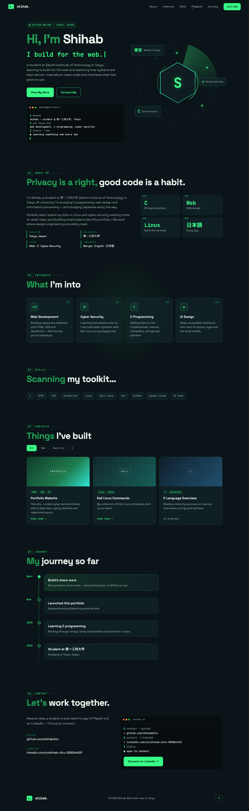

# Shihab — Portfolio

My personal portfolio website: a dark, cyber-terminal themed one-page site.

## Features
- Radar-style animated hero with a hexagon avatar
- Terminal intro that types itself out
- Interests, skills, filterable projects and a journey timeline
- Fully responsive — plain HTML, CSS and JavaScript, no frameworks

## Run locally
Just open `index.html` in a browser.

## Customize
- Put your photo at `assets/profile.jpg` (the hexagon shows an "S" until then).
- Edit text and links in `index.html`.

## Links
- GitHub: [github.com/shihabditu](https://github.com/shihabditu)
- LinkedIn: [linkedin.com/in/shihab-ditu-0550b4421](https://www.linkedin.com/in/shihab-ditu-0550b4421/)
